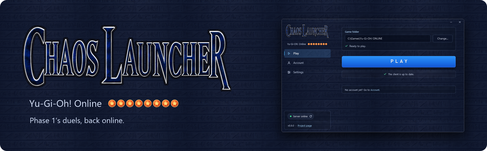
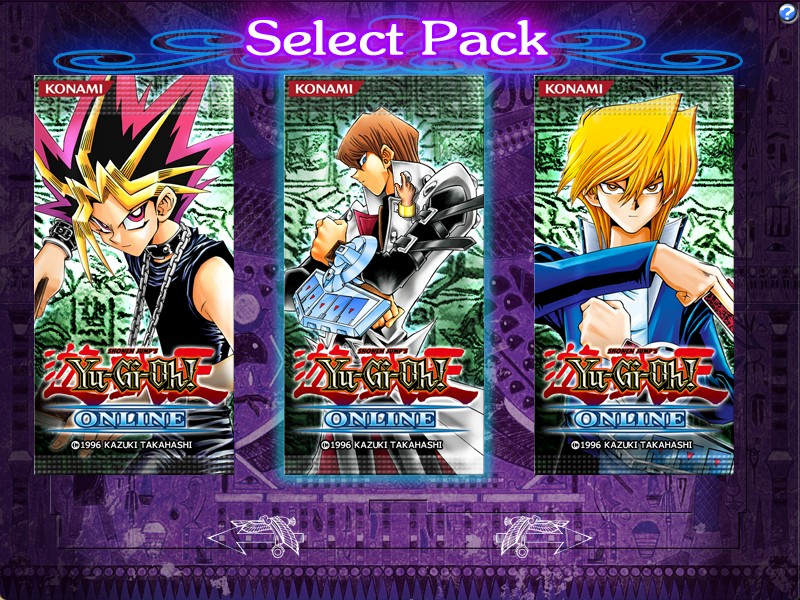
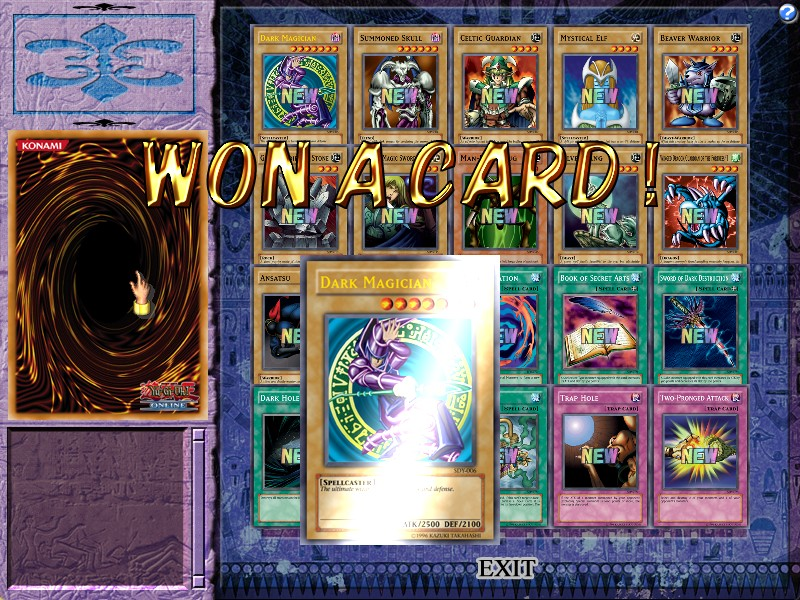

<p align="center">
  
</p>

<p align="center">
  <b>It's time to duel!</b> Yu-Gi-Oh! Online Phase 1 went offline long ago.<br>
  Battle City is a fan-made server that brings it back, and Chaos Launcher connects your copy of
  the game to it.
</p>

<p align="center">
  
  
  
  <a href="LICENSE"></a>
</p>

<p align="center">
  
  
</p>

<p align="center">
  <a href="https://github.com/I-TD-I9/Chaos-Launcher/releases/latest"></a>
</p>

## Getting started

1. You need 64-bit Windows 10 or 11 and Yu-Gi-Oh! ONLINE, the February 2006 version
   (`Ver.060110.00`), unpacked anywhere. The launcher doesn't change your game folder.
2. [Download Chaos Launcher](https://github.com/I-TD-I9/Chaos-Launcher/releases/latest) and run
   it. If Windows says it doesn't recognise the app, click **More info**, then **Run anyway**.
3. Click **Change…** and pick your game folder.
4. Click **Sign in on the website** under **Account**. It opens the Rebirth of Chaos website, where you
   sign in with Discord and pick the UserID and password for the game. You can reset your password
   there too.
5. Click **Play** and log in with your account.

## Good to know

- Your UserID is case-sensitive, and UserIDs and passwords can only have letters and digits.
- The game runs in a small window. To make it bigger, pick a size or **Full screen** for
  **Resolution** under **Settings**. The sizes with a star are the most optimal. Full screen uses your
  main monitor.
- **Play** updates the client from the server first, so the first time can take a moment. On a slow
  connection the rest comes the next time you play.
- The launcher asks to update itself when a new version is out. You can also use **Check for
  updates** under **Settings**.

<p align="center"><b>See you in Battle City!</b></p>

## Building it yourself

With the .NET 10 SDK on Windows:

```
dotnet publish src/Chaos.Launcher -c Release -o publish
```

The first build downloads [cnc-ddraw](https://github.com/FunkyFr3sh/cnc-ddraw), which the launcher
uses for the bigger screens, and checks its hash.

## License

GPL-3.0. cnc-ddraw is under the MIT License, see [THIRD-PARTY-NOTICES.md](THIRD-PARTY-NOTICES.md).
Yu-Gi-Oh! is a trademark of its owners. This project isn't affiliated with or endorsed by Konami.
